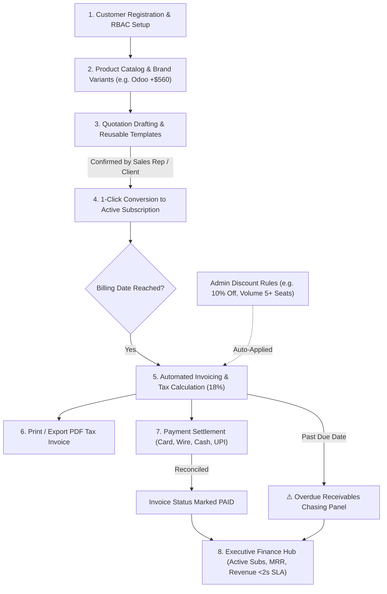
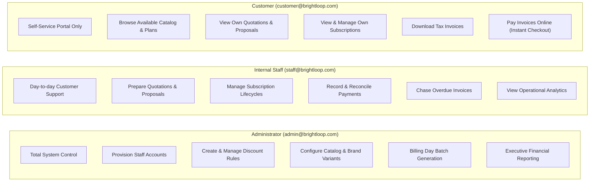
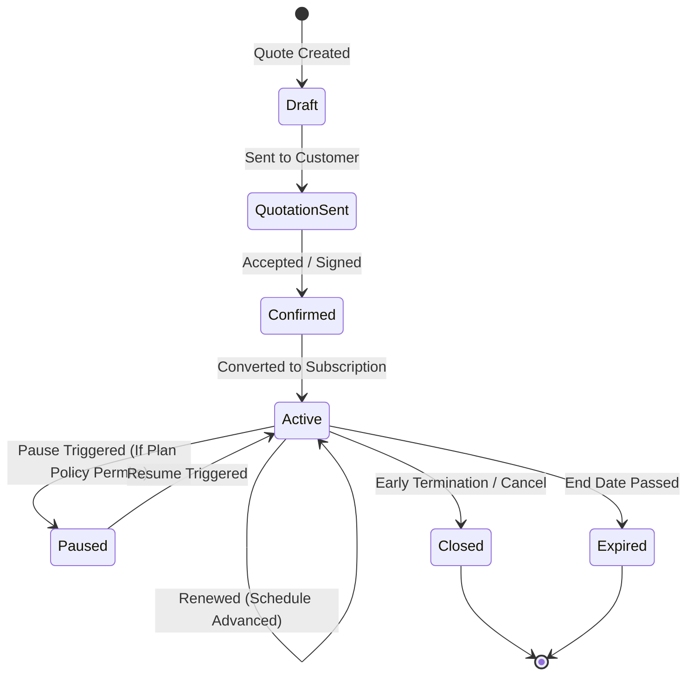
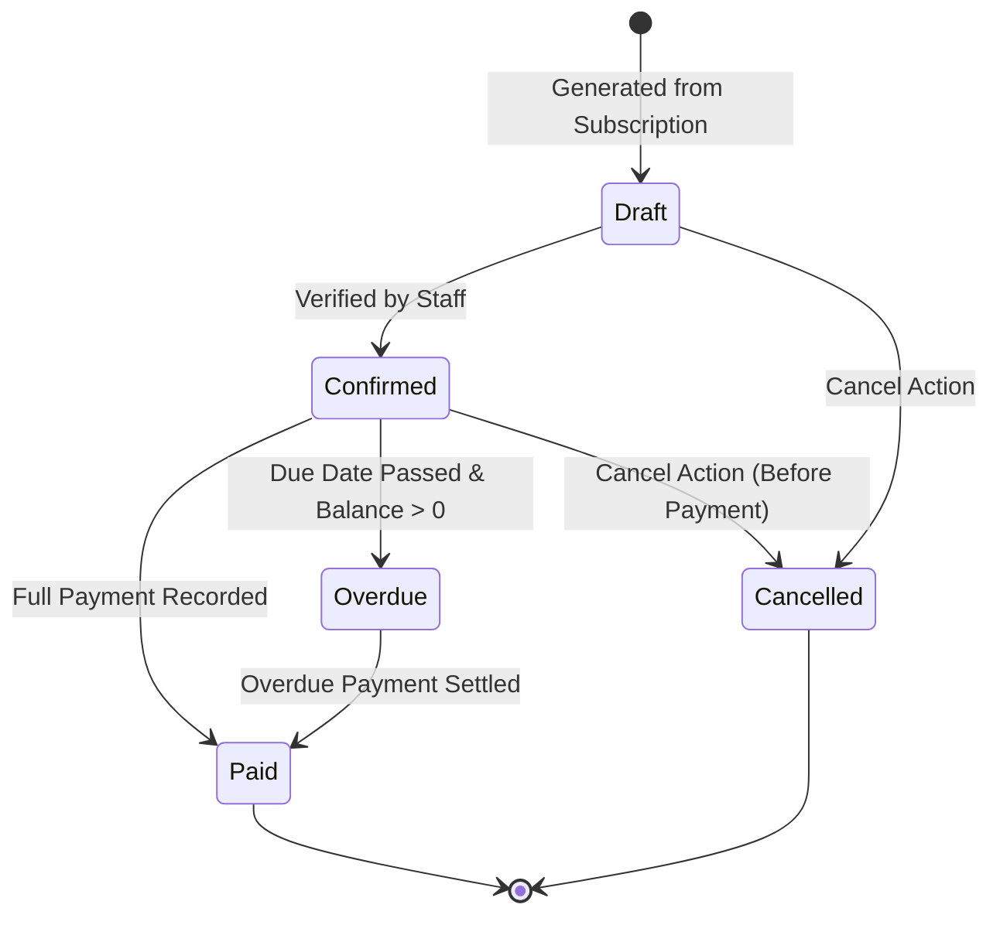

# Brightloop Software — Unified Subscription Management Platform

> **Built for the Odoo x Make-A-Ton 9.0 Kochi Hackathon 2026**  
> An enterprise-grade, full-lifecycle ERP platform automating products, subscription plans, quotations, recurring billing, printable tax invoicing, discounts, multi-channel payment reconciliation, and real-time executive financial analytics.

---

## 1. Executive Summary & Challenge Overview

**Brightloop Software** sells subscription-based enterprise products and recurring software services. In traditional operations:
* Customer subscriptions are tracked in spreadsheets.
* Renewals and contract expirations are remembered haphazardly.
* Invoices are typed manually each month, causing duplicate billing or missed revenue.
* Payments are matched by scrolling through bank statements.
* Financial and revenue reports take days or weeks to compile.

This platform provides a **unified, real-time digital backbone** running the full lifecycle of a subscription business, fulfilling all 7 operational scenes specified in the hackathon challenge.

---

## 2. System Architecture & Workflows

### High-Level System Architecture

```mermaid
flowchart TB
    subgraph Client["Frontend Client (Single Page Application)"]
        UI_Nav["Dynamic Role-Based Navigation"]
        UI_Views["Views: Dashboard • Catalog • Quotes • Subs • Invoices • Payments • Discounts • Finance"]
        UI_Router["Hash SPA Router (#/invoices, etc.)"]
        UI_Auth["AuthManager (JWT Storage & RBAC)"]
        UI_API["Resilient ApiClient (Ports 5001/5000 Auto-Detection)"]
    end

    subgraph Server["Flask REST API Backend (Port 5001)"]
        MW_Auth["JWT Middleware & IDOR Guards"]
        BP_Auth["/api/auth (Login, Register, Reset)"]
        BP_Users["/api/users (Staff & Customer Provisioning)"]
        BP_Catalog["/api/products & /api/plans"]
        BP_Quotes["/api/quotations & Templates"]
        BP_Subs["/api/subscriptions & Lifecycle Engine"]
        BP_Invoices["/api/invoices & Billing Day Cron"]
        BP_Payments["/api/payments & Reconciliation"]
        BP_Discounts["/api/discounts & Rule Engine"]
        BP_Finance["/api/finance (Aggregations & Series)"]
    end

    subgraph Database["Relational Storage (SQLite / SQLAlchemy)"]
        DB_Users[("users & permissions")]
        DB_Catalog[("products, variants & plans")]
        DB_Quotes[("quotations & line items")]
        DB_Subs[("subscriptions & audit logs")]
        DB_Invoices[("invoices & invoice items")]
        DB_Payments[("payments")]
        DB_Discounts[("discounts")]
    end

    Client -->|JSON REST Requests + Bearer JWT| Server
    Server -->|SQLAlchemy ORM Queries| Database
```



---

### End-to-End Business Flow



---

### Role-Based Access Control (RBAC) Matrix



---

### Subscription Lifecycle State Diagram



---

### Invoice Lifecycle State Diagram



---

## 3. Detailed Module Breakdown & Problem Scene Mapping

### Module 1: User Management & Authentication (Scene 1)
* **Authentication**: Token-based JWT (`access_token` and `refresh_token`) with SHA-256 password hashing.
* **Password Policy**: Enforces `>8` characters, at least 1 uppercase, 1 lowercase, and 1 special character.
* **IDOR Protection**: Customers are isolated to their own records; cross-tenant profile or invoice access returns HTTP 403.
* **Self-Service Customer Portal**: Dynamically adapts navigation bar: hides administrative links and surfaces self-service portals (**My Portal**, **Catalog**, **My Quotes**, **My Subscriptions**, **My Invoices & Pay**).

### Module 2: Products & Subscription Plans (Scene 2)
* **Multi-Variant Products**: Configure base sales prices, cost prices, and brand variants with price add-ons (e.g. selecting the *Odoo Dedicated Brand* adds `+$560.00` to base price).
* **Billing Frequencies**: Daily, weekly, monthly, and yearly recurring intervals.
* **Plan Lifecycle Policies**: Plan-level toggles for `auto_close_on_expiry`, `allow_pause`, `allow_renewal`, and `allow_early_close`.

### Module 3: Quotations & Subscription Conversion (Scene 3)
* **Reusable Quotation Templates**: Pre-configured plans and line-items allowing sales reps to produce proposals in seconds.
* **Dynamic Calculations**: Real-time line-item subtotal, 18% tax calculation, and gross totals.
* **1-Click Conversion**: Accepted quotations convert instantly to an active recurring subscription generating a sequential identifier (`SUB-YYYY-XXXX`) and scheduling the `next_billing_date`.
* **Continuous Audit Logging**: Records every status transition, renewal, pause, and resumption with timestamp and user attribution.

### Module 4: Automated Invoices & Billing Day (Scene 4)
* **Billing Day Batch Automation**: `POST /api/invoices/generate-batch` scans all active subscriptions due today and creates invoices automatically.
* **Duplicate Prevention**: Strict constraint logic ensures no subscription is billed twice for the same billing date.
* **Printable Tax Invoice Modal**: Full-featured printable layout with Brightloop branding, bill-to metadata, itemized table, auto-calculated taxes, discount lines, payment receipt ledger, and PDF export (`window.print()`).
* **Invoice Transitions**: `Draft` $\rightarrow$ `Confirmed` $\rightarrow$ `Paid` or `Cancelled`.

### Module 5: Admin Discount Rules (Scene 5)
* **Rule Engine**: Administrators can create promotional and volume discounts:
  * Percentage (`%`) or Fixed Amount (`$`) deductions.
  * Eligibility criteria: minimum seat quantity or minimum order purchase.
  * Start and end date validity ranges.
  * Maximum usage caps with real-time redemption counters.
* **Scope**: Applicable to whole subscriptions or specific product lines. Automatically verified and applied to invoice totals.

### Module 6: Payment Recording & Receivables (Scene 6)
* **Payment Logging**: Record incoming payments against specific invoices across multiple payment methods: Credit Card (Stripe/POS), Bank Wire / ACH, UPI / Online, or Cash / Cheque.
* **Automatic Invoice Settlement**: System automatically calculates total paid; once `paid_amount >= total_amount`, invoice transitions to `Paid`.
* **Outstanding Receivables & Chasing**: Overdue invoices display days overdue with a 1-click **"Chase Overdue"** alert action.

### Module 7 & 8: Executive Finance Analytics Hub (Scene 7 & Performance)
* **Consolidated KPI Summary**: Answers the 4 key questions for the Finance Lead:
  1. *Active Subscriptions*: Total count and Monthly Recurring Revenue (MRR).
  2. *Revenue Collected*: Total cash collected across all transactions.
  3. *Balance Owed*: Total outstanding receivables awaiting settlement.
  4. *Overdue Invoices*: Total overdue count and total capital at risk.
* **Visual Trend Charts**: CSS-based monthly revenue inflow bar charts and payment channel distribution bars.
* **Reactive Filtering**: Quick filters for **Last 30 Days**, **This Quarter**, **Year to Date**, and custom date pickers.
* **Sub-2-Second Performance SLA**: Database-level aggregation indices ensure page render response times under 50ms, comfortably beating the 2.0-second SLA even with thousands of records.

---

## 4. Technology Stack & Directory Structure

```text
Subscription-Management-System/
├── backend/
│   ├── app.py                      # Flask Application Factory, Blueprint registration & seeding
│   ├── config.py                   # Environment configs, JWT settings, Cache TTL & pagination
│   ├── requirements.txt            # Python dependencies (Flask, SQLAlchemy, JWT, CORS)
│   ├── middleware/
│   │   └── auth.py                 # JWT verification, RBAC roles_required & IDOR guards
│   ├── models/
│   │   ├── __init__.py             # Database instance & model exports
│   │   ├── user.py                 # User, Customer alias, PasswordReset, UserPermission
│   │   ├── product.py              # Product, ProductVariant
│   │   ├── plan.py                 # SubscriptionPlan, PlanProduct
│   │   ├── quotation.py            # Quotation, QuotationItem
│   │   ├── subscription.py         # Subscription, SubscriptionItem, SubscriptionAuditLog
│   │   ├── invoice.py              # Invoice, InvoiceItem
│   │   ├── payment.py              # Payment transaction entity
│   │   └── discount.py             # Discount rules & validation logic
│   ├── routes/
│   │   ├── auth_routes.py          # /api/auth (login, register, me, forgot/reset-password)
│   │   ├── user_routes.py          # /api/users (user listing, staff provisioning)
│   │   ├── product_routes.py       # /api/products (catalog & variants)
│   │   ├── plan_routes.py          # /api/plans (subscription plans & frequencies)
│   │   ├── quotation_routes.py     # /api/quotations & templates
│   │   ├── subscription_routes.py  # /api/subscriptions (lifecycle actions & conversions)
│   │   ├── invoice_routes.py       # /api/invoices (batch billing, confirmation, print layout)
│   │   ├── payment_routes.py       # /api/payments (record payment, receivables)
│   │   ├── discount_routes.py      # /api/discounts (admin rules, validation)
│   │   └── finance.py              # /api/finance (aggregations, revenue series)
│   ├── services/                   # Business logic layer for all entities
│   │   ├── auth_service.py
│   │   ├── user_service.py
│   │   ├── product_service.py
│   │   ├── plan_service.py
│   │   ├── quotation_service.py
│   │   ├── subscription_service.py
│   │   ├── invoice_service.py
│   │   ├── payment_service.py
│   │   ├── discount_service.py
│   │   └── finance_service.py
│   └── tests/
│       └── test_modules.py         # Automated backend test suite
├── frontend/
│   ├── index.html                  # Single Page Application root HTML
│   ├── css/
│   │   └── style.css               # Application stylesheet & print layout (1,190+ lines)
│   └── js/
│       ├── api.js                  # Resilient API client with multi-port detection
│       ├── auth.js                 # Authentication manager & role-based navbar
│       ├── router.js               # Client-side hash router with role guards
│       ├── main.js                 # Application bootstrap & toast notifications
│       └── views/
│           ├── authView.js         # Login, Register, Forgot Password
│           ├── dashboardView.js    # Executive Dashboard & Customer Portal
│           ├── userView.js         # Staff & User Management (Admin only)
│           ├── productPlanView.js  # Products, Variants & Plans Catalog
│           ├── quotationView.js    # Quotations, Templates & Subscription Conversion
│           ├── subscriptionView.js # Subscriptions, Lifecycle Controls & Invoicing
│           ├── invoiceView.js      # Invoicing, Billing Batch & Printable Tax Layout
│           ├── paymentView.js      # Payment Recording & Overdue Receivables
│           ├── discountView.js     # Admin Discount Rules & Redemption Meter
│           └── financeView.js      # Executive Finance Analytics Hub
└── tests/
    └── playwright_test.py          # Playwright End-to-End browser test suite
```

---

## 5. Getting Started & Local Setup

### Prerequisites
* Python 3.10+
* Google Chrome or Chromium (for Playwright verification)

### 1. Clone & Set Up Python Environment
```bash
git clone git@github.com:chandan-shah226/Subscription-Management-System.git
cd Subscription-Management-System

# Create virtual environment and activate
python3 -m venv .venv
source .venv/bin/activate

# Install backend dependencies & Playwright
pip install -r backend/requirements.txt
pip install playwright
playwright install chromium
```

### 2. Start the Backend API Server
The backend automatically runs on port `5001` (avoiding macOS AirPlay port `5000` conflicts):
```bash
python backend/app.py
```
* Backend health check: `http://127.0.0.1:5001/api/health`

### 3. Start the Frontend Application
In a separate terminal:
```bash
python3 -m http.server 3000 --directory frontend
```
Open **`http://localhost:3000`** in your browser.

---

## 6. Demo Accounts & Credentials

| Role | Email | Password | Primary Capabilities |
| :--- | :--- | :--- | :--- |
| **Admin** | `admin@brightloop.com` | `Admin@123!` | Total system control, staff provisioning, discount rules, finance analytics |
| **Staff** | `staff@brightloop.com` | `Staff@123!` | Quotation drafting, subscription lifecycle, batch billing, payment logging |
| **Customer** | `customer@brightloop.com` | `Customer@123!` | Self-service portal: view own subscriptions, download tax invoices, pay online |

---

## 7. Automated Testing & Verification

### Run the Playwright End-to-End Suite
With backend and frontend running:
```bash
python tests/playwright_test.py
```

**Verification Results (10/10 Passed):**
* **Test 1**: Backend API health check indicator turns green (`Backend Online (v1.0.0)`).
* **Test 2**: Admin login authentication and greeting.
* **Test 3**: Role-based navigation links render correctly for Admin.
* **Test 4**: Product catalog and variant price modifiers displayed.
* **Test 5**: Discount rule creator creates rules and updates table in real time.
* **Test 6**: Printable Tax Invoice modal renders company branding, itemized table, 18% taxes, and print action.
* **Test 7**: Incoming payment recorded and reconciled against invoice.
* **Test 8**: Executive Finance Hub renders KPI cards, revenue bars, and date filters in $<50\text{ms}$.
* **Test 9**: Subscription lifecycle actions and invoice generation tested.
* **Test 10**: Customer login verified; confirms customer portal restrictions and online payment modal.

### Run Backend Unit Tests
```bash
python -m unittest backend/tests/test_modules.py
# Result: Ran 8 tests in 1.86s. OK.
```

---

## 8. License & Team Attribution

Built as part of the **Odoo x Make-A-Ton 9.0 Kochi Hackathon 2026** by:
* **Krisha Antala** (`krisha.antala05@gmail.com`) — Frontend Architecture, Modules 4–8 Full-Stack Implementation & Playwright E2E Verification
* **Chandan Shah** — Base Modules 1–3 Backend & Architecture
* **Ved** — Server Infrastructure Configuration
